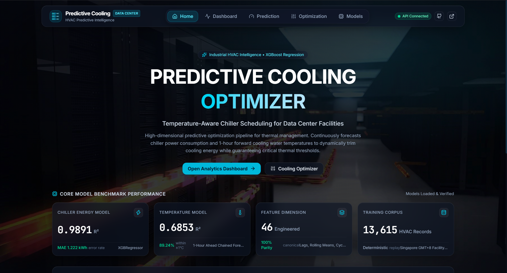

# 数据中心预测性冷却优化：基于温度感知的冷水机组调度与能耗降低
[English](README.md) | [தமிழ்](README_TA.md) | 中文 | [हिन्दी](README_HI.md) | [Bahasa Indonesia](README_ID.md)


[](LICENSE)


本项目旨在解决数据中心冷却系统中的能源效率问题。项目通过开发一种基于温度感知的预测模型，对冷水机组的运行调度进行优化，从而在确保热安全的同时降低能源消耗。传统的响应式冷却系统通常会在温度变化发生后才进行响应，这容易造成能源浪费以及冷水机组运行效率低下。



## 项目方法

本项目首先对 13,615 条 HVAC 样本进行了全面的数据预处理，包括使用 IQR 方法进行异常值检测、通过 MinMaxScaler 进行归一化处理，以及按照时间顺序进行 80-20 的训练集与测试集划分，以保持数据的时间完整性。

通过特征工程共构建了 46 个增强特征，包括 16 个滞后特征（Lag Features）、12 个滚动平均特征（Rolling Averages）、6 个周期性时间编码特征（Cyclical Temporal Encodings）以及 4 个交互特征（Interaction Features），从而更好地捕捉系统复杂的动态变化。

两个 XGBoost 回归模型构成了核心预测引擎：

* **能源预测模型**：R² = 0.9891，MAE = 1.222 kWh
* **温度预测模型**：R² = 0.6853，其中 89.24% 的预测结果位于 ±1°C 的误差范围内

两个模型都表现出了较高的训练效率。能源预测模型的训练时间为 2.12 秒，温度预测模型的训练时间为 1.87 秒，因此具备实时部署的可行性。

`PredictiveCoolingOptimizer` 类将两个模型进行集成，并通过基于约束的温度管理与能源最小化策略，实现整个冷却系统的优化。

## 测试

项目共进行了 11 项测试，分为五个类别，具体如下：

|            测试类型           |        测试目标        |   状态    |
| :--------------------------: | :--------------------: | :------: |
| 单元测试（Unit Tests）        | 能源与温度模型、优化引擎 | ✅ 通过  |
| 集成测试（Integration Tests） | 端到端流水线、系统集成   | ✅ 通过  |
| 功能测试（Functional Tests）  | 准确率、响应时间与逻辑   | ✅ 通过  |
| 白盒测试（White Box Test）    | 超参数、特征工程         | ✅ 通过  |
| 黑盒测试（Black Box Test）    | 边界值、输出一致性       | ✅ 通过  |
|                              | 通过的测试              | 11/11    |
|                              | 失败的测试              | 0/11     |
|                              | 成功率                  | 100.0% |

## 执行步骤

程序的运行过程非常简单，只需按照以下步骤操作即可。

1. 安装所需的库：

```bash
pip install -r requirements.txt
```

2. 启动 FastAPI 后端服务（端口 8000）：

```bash
uvicorn backend.main:app --host 127.0.0.1 --port 8000
```

3. 启动 React 前端应用（端口 5173）：

```bash
cd frontend
npm install
npm run dev
```

## 使用的工具

1. Anaconda Jupyter：用于初始模型训练与科学验证
2. FastAPI 与 Uvicorn：用于高性能计算服务
3. React 与 Vite：用于现代化前端交互界面
4. NumPy、Pandas 与 Scikit-Learn
5. XGBoost：核心回归预测引擎

## 使用的算法

### 1. 预测算法

* XGBoost（Extreme Gradient Boosting，极端梯度提升）
* Sequential Chained Regression（链式顺序推断）

### 2. 支持算法

* Min-Max Normalization（最小-最大归一化）
* 46 维特征工程（滞后、滑动统计与交互特征）

该工具成功验证了基于软件的数据中心预测性冷却优化方案的可行性。训练完成的模型现已部署于基于 React + FastAPI 的现代 Web 架构中。

## 许可证

本项目采用 MIT License 许可证。详情请参阅 [LICENSE](LICENSE) 文件。

<a href="https://www.star-history.com/">
 <picture>
   <source media="(prefers-color-scheme: dark)" srcset="https://api.star-history.com/chart?repos=vk22006/predictive-cooling-optimizer-for-data-centers&type=date&theme=dark&legend=top-left" />
   <source media="(prefers-color-scheme: light)" srcset="https://api.star-history.com/chart?repos=vk22006/predictive-cooling-optimizer-for-data-centers&type=date&legend=top-left" />
   
 </picture>
</a>
